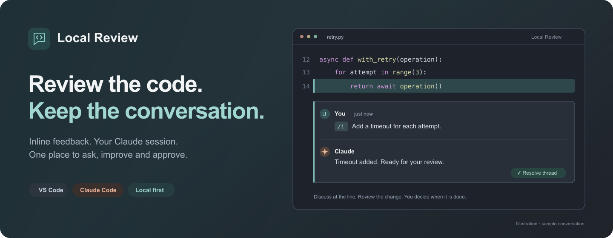
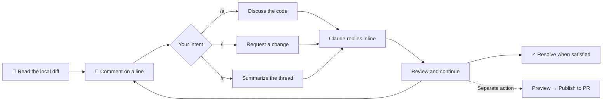
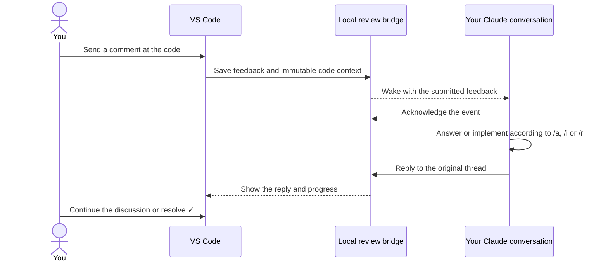

<p align="center">
  
</p>

<p align="center">
  
  
  
  
</p>

<p align="center">
  <b>Review local changes with Claude, right where you read the code.</b><br>
  Leave a comment in VS Code. Ask a question or request a change.<br>
  Claude receives it automatically and replies in the same inline conversation.
</p>

<p align="center">
  <a href="https://github.com/kaiketsu-labs/local-review/releases">Download</a> ·
  <a href="docs/INSTALL.md">Installation guide</a> ·
  <a href="docs/USAGE.md">Full guide</a> ·
  <a href="https://github.com/kaiketsu-labs/local-review/issues">Issues</a>
</p>

---

## Why

Reviewing an agent's changes often means copying code into a terminal, explaining which lines you mean, and finding the answer again later. A GitHub draft review keeps the context together, but takes you out of the local editing loop.

Local Review brings that conversation into the editor: **feedback attached to a line, delivered to Claude, with the answer returned to the same thread.** Keep reading the diff while the agent works. Resolve the thread when you are satisfied.

<p align="center">
  <a href="docs/media/local-review-demo.mp4"></a>
  <br><sub>Staged demo with simulated responses and the optional side composer. The default input uses native inline comments.</sub>
</p>

## Features

| | |
| --- | --- |
| 💬 **Review at the line** | Native inline comments in local files and diffs, with captured code context attached to each submitted comment. |
| ⚡ **Automatic delivery** | Send feedback once; your connected Claude conversation receives it without a separate review submission. |
| 🎛️ **Ask, implement, summarize** | Use `/a` to discuss, `/i` to request a change, and `/r` to summarize the thread. |
| 🎨 **Readable code** | Padded code cards, syntax colors and a small editor icon for opening the source with native navigation. |
| 📌 **Keep your draft** | An optional compact side composer follows new selections while empty and keeps written feedback attached to its original code. |
| ✅ **You resolve it** | Claude reports progress and replies. You decide when a thread is done; completed threads can be reopened. |
| 🔁 **Choose your conversation** | Search saved conversations by name or branch, start a new one, or connect the conversation already running in your terminal. |
| 🔗 **Carry it into a PR** | Preview summaries and unresolved questions, edit the text, then explicitly publish to the branch's existing GitHub PR. |
| 🎙️ **Speak your feedback** | Use existing macOS Dictation in the comment field, without an extra recorder or transcription account. |

## The review loop



| Write | Result |
| --- | --- |
| `/a Why use a fixed delay here?` | Claude explains the decision in the thread. |
| `/i Add a timeout for each attempt.` | Claude implements the requested change and returns it for review. |
| `/r` | Claude summarizes the existing conversation and remaining decisions. |

`/a` and `/r` request discussion without edits; they are not a separate permission sandbox. Claude's existing tool permissions still apply. `/r` never publishes anything to GitHub.

## Install

**Install the VS Code extension**

Download a `.vsix` from [GitHub Releases](https://github.com/kaiketsu-labs/local-review/releases), then use **Extensions → … → Install from VSIX…**. The extension is not on the Marketplace yet.

Or install a downloaded package from your terminal:

```bash
code --install-extension ./local-review-<version>.vsix --force
```

**Connect Claude**

Open a trusted local Git repository and run **Local Review: Mit Claude verbinden**.

| Choose | What happens |
| --- | --- |
| **Unterhaltung auswählen** | Search this project's recent conversations by name or branch. Running conversations are marked **Läuft**. |
| **Neue Unterhaltung** | Start a fresh Claude conversation with review feedback enabled. |
| **Laufende Unterhaltung verbinden** | Keep your original Claude process and conversation. Copy the two commands shown in VS Code into that conversation. |

To connect a running conversation, execute `/reload-plugins --force`, then `/local-review:connect` inside it. This requires **Claude Code 2.1.280+** and installs a project-local plugin; reloading rereads the conversation context once. Wait for **Feedback aktiv** before sending a comment.

For a separate terminal app, the same running-conversation commands apply. To start or resume there instead, use **Review → … → Verbindungsbefehl kopieren** at its shell prompt. Keep the project's VS Code window open. [Connection details →](docs/CLAUDE-SESSION-ATTACH.md)

**Leave your first comment**

Open **Local Review: Änderungen reviewen**, click the gutter **+**, or select code and press **⌘⌥M** on macOS / **Ctrl+Alt+M** on Linux. Write `/a` or `/i` followed by your feedback and choose **Senden**. Continue in the thread's reply field.

Requires **VS Code 1.100+**, **Node.js 22+**, **Git**, and authenticated **Claude Code with `asyncRewake` support**. macOS is the verified primary platform; Linux is unverified, and automatic Windows connection is not supported yet. [Setup and troubleshooting →](docs/INSTALL.md)

## How it works



A small local helper waits for saved feedback; the LLM does not repeatedly check for comments. Claude answers through review tools, which return the reply to VS Code. A connection or notification alone does not acknowledge delivery.

Threads and private connection files live in VS Code's workspace storage. The launched-session flow passes settings to Claude without replacing your existing project configuration. Running-conversation setup uses Claude's plugin manager with local scope and preserves existing settings. Only the explicitly selected conversation can receive feedback through that plugin. [Architecture and walkthrough →](docs/HOW-IT-WORKS.md)

## Make it yours

| Action / setting | Effect |
| --- | --- |
| **Kommentarfenster hervorheben** | Apply a distinct thread surface, reply fill and neutral border in this project. The paired reset action restores prior colors. VS Code shares these tokens with other comments and Peek views. |
| **Zentrierte Ansicht** | Narrow the source editor and its inline conversations together. VS Code controls native comment width. |
| **Feedback in Seitenansicht schreiben** | Open the optional compact composer with mode buttons, saved drafts and selection following. |
| `localReview.claudePath` | Choose your Claude executable when multiple installations exist. |
| `localReview.nodePath` | Choose the Node.js 22+ executable used by the integration. |
| `localReview.transport` | `hooks` is the default. `channels` is an experimental alternative with additional prerequisites. |

The interface currently uses German labels. Code previews provide display colors; use the editor icon for hover, references and language-server navigation. [Full usage guide →](docs/USAGE.md)

## Roadmap and verification

- [x] Native inline questions, change requests and thread summaries
- [x] Automatic feedback delivery and replies to the original thread
- [x] Specific saved conversation or new conversation
- [x] Human resolution, hidden completed threads and reopening
- [x] Editable preview before publishing to an existing PR
- [x] Connect to an already-running conversation without restarting it
- [ ] Unread reply navigation and direct Claude-to-thread navigation
- [ ] VS Code Marketplace / Open VSX publication
- [ ] Linux and Windows verification

The [running-conversation verification](docs/QA-2026-10-26.md) records an authenticated Claude session started before setup, unchanged process/session identity after connecting, and a real inline question and formatted reply. Strict TypeScript and **256 tests** pass. Busy-agent delivery, a full separate-terminal roundtrip and real remote PR publication remain separate verification tasks. [Earlier native review](docs/UX-REVIEW-2026-10-21.md) · [Review tracker](docs/REVIEW.md)

## Development

```text
local-review/
├── src/             VS Code UI, durable review store, bridge and Claude integration
├── test/            Controller, rendering and real-process transport tests
├── resources/       Extension icon and review avatars
└── docs/            Setup, architecture, demos, publishing and QA evidence
```

```bash
git clone https://github.com/kaiketsu-labs/local-review.git
cd local-review
npm ci --ignore-scripts
npm run typecheck
npm test
npm run package
```

The generated `.vsix` can be installed through VS Code. [Contributing](CONTRIBUTING.md) · [Publishing guide](docs/PUBLISHING.md)

Built on the [VS Code Comments API](https://code.visualstudio.com/api/references/vscode-api#CommentController), [Claude hooks](https://code.claude.com/docs/en/hooks), and [MCP](https://code.claude.com/docs/en/mcp). Not affiliated with Anthropic or Microsoft.
