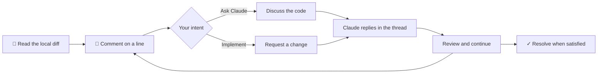
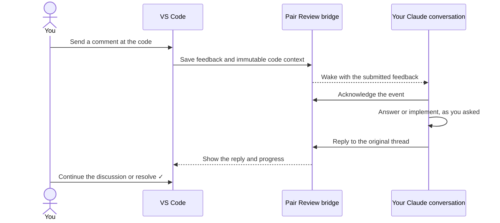

<p align="center">
  
</p>

<p align="center">
  
  
  
  
</p>

<p align="center">
  <b>Review local changes with Claude, right where you read the code.</b><br>
  Leave a comment on the review page. Ask a question or request a change.<br>
  Claude receives it automatically and replies in the same thread.
</p>

<p align="center">
  <a href="https://github.com/kaiketsu-labs/pair-review/releases">Download</a> ·
  <a href="https://github.com/kaiketsu-labs/pair-review/blob/main/docs/INSTALL.md">Installation guide</a> ·
  <a href="https://github.com/kaiketsu-labs/pair-review/blob/main/docs/USAGE.md">Full guide</a> ·
  <a href="https://github.com/kaiketsu-labs/pair-review/issues">Issues</a>
</p>

---

## Why

Reviewing an agent's changes often means copying code into a terminal, explaining which lines you mean, and finding the answer again later. A GitHub draft review keeps the context together, but takes you out of the local editing loop.

Pair Review brings that conversation into the editor: **feedback attached to a line, delivered to Claude, with the answer returned to the same thread.** Keep reading the diff while the agent works. Resolve the thread when you are satisfied.

<p align="center">
  <a href="https://github.com/kaiketsu-labs/pair-review/blob/main/docs/media/pair-review-demo.mp4"></a>
  <br><sub>Staged demo of an earlier version, with simulated responses and native inline comments. Comments now live on the review page.</sub>
</p>

## Features

| | |
| --- | --- |
| 💬 **Review at the line** | The review page shows your uncommitted changes, new files and any file you open from the **Local** view, with comment threads on their lines. |
| ⚡ **Automatic delivery** | Send feedback once; your connected Claude conversation receives it without a separate review submission. |
| 🎛️ **Ask or implement** | **Ask Claude** discusses the lines; **Implement** asks Claude to change them. |
| ✍️ **Comment from the editor** | Select code and press **⌘⌥M** / **Ctrl+Alt+M** to open a comment on those lines on the review page. |
| ✅ **You resolve it** | Claude reports progress and replies. You decide when a thread is done; completed threads can be reopened. |
| 🔁 **Choose your conversation** | Search saved conversations by name or branch, start a new one, or connect the conversation already running in your terminal. |
| 🧭 **Guided PR review** | Claude groups a PR's changes by severity, orders them for reading and explains each step. Every change lands in one step, so ticking Viewed on each step covers the whole PR. The Pull Requests sidebar lists the steps under the PR; click one to jump to it. |
| 🐙 **The whole GitHub PR** | The review page covers GitHub's PR tabs: conversation with comments, reviews, reactions, edits and events; commits with per-commit diffs and changes since your last review; file filters and hidden whitespace; check annotations and re-runs; and a merge box with branch protection, update branch, auto-merge, merge queue and revert. |
| 🎙️ **Speak your feedback** | Use existing macOS Dictation in the comment field, without an extra recorder or transcription account. |

## The review loop



| Choose | Result |
| --- | --- |
| **Ask Claude** · "Why use a fixed delay here?" | Claude explains the decision in the thread. |
| **Implement** · "Add a timeout for each attempt." | Claude implements the requested change and returns it for review. |

**Ask Claude** requests discussion without edits; it is not a separate permission sandbox. Claude's existing tool permissions still apply.

## Install

**Install the VS Code extension**

Download a `.vsix` from [GitHub Releases](https://github.com/kaiketsu-labs/pair-review/releases), then use **Extensions → … → Install from VSIX…**. The extension is not on the Marketplace yet.

Or install a downloaded package from your terminal:

```bash
code --install-extension ./pair-review-<version>.vsix --force
```

**Connect Claude**

Open a trusted local Git repository and run **Pair Review: Mit Claude verbinden**.

| Choose | What happens |
| --- | --- |
| **Unterhaltung auswählen** | Search this project's recent conversations by name or branch. Running conversations are marked **Läuft**. |
| **Neue Unterhaltung** | Start a fresh Claude conversation with review feedback enabled. |
| **Laufende Unterhaltung verbinden** | Keep your original Claude process and conversation. Copy the two commands shown in VS Code into that conversation. |

To connect a running conversation, execute `/reload-plugins --force`, then `/pair-review:connect` inside it. This requires **Claude Code 2.1.280+** and installs a project-local plugin; reloading rereads the conversation context once. Wait for **Feedback aktiv** before sending a comment.

For a separate terminal app, the same running-conversation commands apply. To start or resume there instead, use **Review → … → Verbindungsbefehl kopieren** at its shell prompt. Keep the project's VS Code window open. [Connection details →](https://github.com/kaiketsu-labs/pair-review/blob/main/docs/CLAUDE-SESSION-ATTACH.md)

**Leave your first comment**

Open the **Local** view in the Pair Review sidebar and click **Review local changes**, or select code in the editor and press **⌘⌥M** on macOS / **Ctrl+Alt+M** on Linux. On the review page, click a line number, write your feedback and choose **Ask Claude** or **Implement**. Continue in the thread's **Reply**. Clicking a file in the **Local** view shows it on the page, even without changes.

Requires **VS Code 1.100+**, **Node.js 20+**, **Git**, and authenticated **Claude Code with `asyncRewake` support**. macOS is the verified primary platform; Linux is unverified, and automatic Windows connection is not supported yet. [Setup and troubleshooting →](https://github.com/kaiketsu-labs/pair-review/blob/main/docs/INSTALL.md)

## How it works



A small local helper waits for saved feedback; the LLM does not repeatedly check for comments. Claude answers through review tools, which return the reply to VS Code. A connection or notification alone does not acknowledge delivery.

Threads and private connection files live in VS Code's workspace storage. The launched-session flow passes settings to Claude without replacing your existing project configuration. Running-conversation setup uses Claude's plugin manager with local scope and preserves existing settings. Only the explicitly selected conversation can receive feedback through that plugin. [Architecture and walkthrough →](https://github.com/kaiketsu-labs/pair-review/blob/main/docs/HOW-IT-WORKS.md)

## Make it yours

| Action / setting | Effect |
| --- | --- |
| `pairReview.claudePath` | Choose your Claude executable when multiple installations exist. |
| `pairReview.nodePath` | Choose the Node.js 20+ executable used by the integration. |
| `pairReview.transport` | `hooks` is the default. `channels` is an experimental alternative with additional prerequisites. |

Some labels are still German. On the review page, Cmd/Ctrl-click a name to peek at its definition, or use **Open in editor**. [Full usage guide →](https://github.com/kaiketsu-labs/pair-review/blob/main/docs/USAGE.md)

## Roadmap and verification

- [x] Questions and change requests on the review page, for local changes and PRs
- [x] Automatic feedback delivery and replies to the original thread
- [x] Specific saved conversation or new conversation
- [x] Human resolution, hidden completed threads and reopening
- [x] Connect to an already-running conversation without restarting it
- [x] Unread reply navigation and direct Claude-to-thread navigation
- [ ] VS Code Marketplace / Open VSX publication
- [ ] Linux and Windows verification

Guide notes are stored as threads that start with Claude's message. Versions before guided review cannot load a PR's comments once it has a guide.

The [running-conversation verification](https://github.com/kaiketsu-labs/pair-review/blob/main/docs/QA-2026-10-26.md) records an authenticated Claude session started before setup, unchanged process/session identity after connecting, and a real inline question and formatted reply. Strict TypeScript and **272 tests** pass. Busy-agent delivery, a full separate-terminal roundtrip and real remote PR publication remain separate verification tasks. [Earlier native review](https://github.com/kaiketsu-labs/pair-review/blob/main/docs/UX-REVIEW-2026-10-21.md) · [Review tracker](https://github.com/kaiketsu-labs/pair-review/blob/main/docs/REVIEW.md)

## Development

```text
pair-review/
├── src/             VS Code UI, durable review store, bridge and Claude integration
├── test/            Controller, rendering and real-process transport tests
├── resources/       Extension icon and review avatars
└── docs/            Setup, architecture, demos, publishing and QA evidence
```

```bash
git clone https://github.com/kaiketsu-labs/pair-review.git
cd pair-review
npm ci --ignore-scripts
npm run typecheck
npm test
npm run package
```

The generated `.vsix` can be installed through VS Code. `make install` packages it and installs it in one step; `make` lists the other targets. [Contributing](https://github.com/kaiketsu-labs/pair-review/blob/main/CONTRIBUTING.md) · [Publishing guide](https://github.com/kaiketsu-labs/pair-review/blob/main/docs/PUBLISHING.md)

Built on [VS Code webviews](https://code.visualstudio.com/api/extension-guides/webview), [Claude hooks](https://code.claude.com/docs/en/hooks), and [MCP](https://code.claude.com/docs/en/mcp). Not affiliated with Anthropic or Microsoft.

The [PR management reliability review](https://github.com/kaiketsu-labs/pair-review/blob/main/docs/QA-PR-MANAGEMENT-2026-11-03.md) records partial-write recovery fixes, 364 passing automated tests, and the still-pending real GitHub and native VS Code verification.
